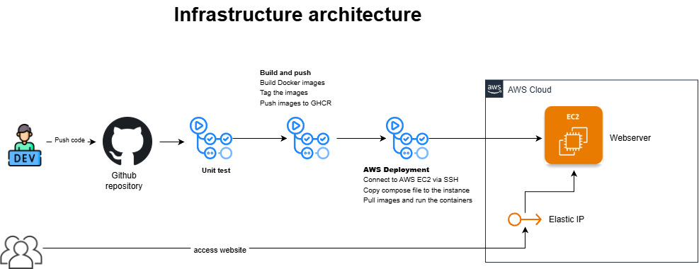

# Microshop: a microservice e-commerce shop

I created this project in order to learn DevOps tools step by step: a basic ECommerce microservice project with a CI/CD pipeline using Github actions, Docker and deployment to an AWS EC2 instance.

## Architecture


```
Browser
   │
   ▼
frontend (nginx)  ── serves the web page and forwards /api/* to the services
   │
   ├── /api/products ──> product-service ──> PostgreSQL
   ├── /api/cart ──────> cart-service ─────> Redis
   └── /api/orders ────> order-service ────> PostgreSQL
                              │
                              ├──> cart-service     (read and clear the cart)
                              └──> product-service  (read current prices)

```
The project consists of 4 services: 1 front-end service and 3 back-end services: product-service, cart-service and order-service. The code was generated by Claude. I focused on infrastructure side by implementing the Docker files, github action file and setup an EC2 instance on AWS. 

Frontend server: a Nginx webserver with published port 8080. Technology: nginx, plain HTML/JS
Product-service: Used for product catalog. Technology: Node.js, Express, PostgreSQL
Cart-service: Used for shopping cart. Technology: Node.js, Express, Redis
Order-service: Used for checking out and order history. Technology: Node.js, Express, PostgreSQL

   
Every service listens on port 3000 inside its container and exposes
`/healthz` (the process is alive) and `/readyz` (it can reach its database).

Repository layout

```
services/<name>/        source code, tests and Dockerfile of each service
docker-compose.yml      runs everything on one machine
.github/workflows/      CI/CD pipeline (ci1.yml) and a practice workflow (hello.yml)
```

## Prepare the EC2 instance (manually)

Choose an option for EC2 instance, such as t3.small. 

Make a SSH connection to the instance and:
1. Install Docker and the Compose plugin. 
2. Create a folder for the app: sudo mkdir -p shop && sudo chown $USER shop
3. Create shop/.env with the real database password. 
4. Open or create a new security group for port 22 (SSH) and port 8080 (the frontend), or whichever port we map the frontend to.
5. Attach an Elastic IP to the EC2 instance. Without this step, it can be difficult to reach the server consistently because whenever the instance restarts, its IP address changes.

Add secrets in Github:
In the repository, go to settings -> Secrets and variables -> Actions and add:
- EC2_HOST: the Elastic IP
- EC2_USER: your user on the EC2 instance
- EC2_SSH_KEY: the full content of your .pem private key


## Run with Docker Compose

Requires Docker Desktop.

```powershell
docker compose up --build -d     # build the images and start everything
docker compose ps                # see the containers
docker compose logs -f order-service
docker compose down              # stop (add -v to also delete the database)
```

Open http://localhost:8080

## CI/CD with GitHub Actions

`.github/workflows/ci1.yml` runs on every push (any branch) and every pull request:

1. **Test**: `npm ci` and `npm test` for each Node.js service, in parallel.
2. **Build**: builds one Docker image per service.
   On a push (not on pull requests) it also pushes the images to the GitHub
   Container Registry as `ghcr.io/<owner>/<repo>/<service>:sha-<commit>`,
   plus `:latest` when the push is on `main`.

To turn it on, push this folder to a GitHub repository:

```powershell
git init -b main
git add .
git commit -m "Initial commit"
git remote add origin https://github.com/<your-user>/<your-repo>.git
git push -u origin main
```

Then open the **Actions** tab of the repository to watch the pipeline.

## Roadmap

- [x] Services, Dockerfiles, Docker Compose
- [x] CI: test, build and push images to GHCR
- [x] CD: deploy the application to AWS from GitHub Actions
- [ ] Later: Using more services in AWS such as Route53, EKS, ECS, ..., applying Kubernetes, monitoring (Prometheus/Grafana), Ansible, Jenkins
